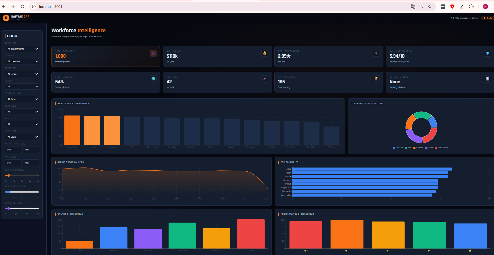

# SaiyanCorp Dashboard

An interactive workforce analytics dashboard: 15 filters on the left, KPI cards and 14 charts on the right, all recalculated on every filter change. It runs on a **fictional** company of 1,000 employees whose data is generated in memory and served through a Next.js API route.

**Stack:** Next.js 14 (App Router, route handlers) · React 18 · TypeScript · Tailwind CSS 3 · Recharts · lucide-react

**Live demo:** <https://saiyan-corp-dashboard.vercel.app/>

> **Note:** this is a personal side project. At the start of 2026 I joined a cross-functional SDLC team that shared work with data science and backend, where data was turned into dashboards. I built this, like [nebula-hr-analytics](https://github.com/horaciodemaria-dev/nebula-hr-analytics), to practice the data and backend side (how data is generated, filtered and aggregated behind an API), with AI assistance, and to finish on the part I do professionally: the frontend that makes that data visible. It is not actively maintained.

> **All data is fictional.** Employee names are deliberately taken from Dragon Ball and Marvel characters so it is obvious the data is made up. No real people, companies or HR systems are involved, and nothing here comes from any employer or client.



## What it does

**Filters (15)**: department, gender, country, seniority, contract type, work mode (remote / on-site), education, hire year, salary range, age range, minimum performance, minimum satisfaction and minimum years of experience.

**KPI cards**: total employees, average salary, average performance, average satisfaction, remote workers, average age, number of top performers and number of active filters.

**Charts (14)**:

- Headcount by department
- Seniority distribution
- Hiring trend by year
- Top countries
- Salary distribution
- Performance distribution
- Average salary by department
- Education
- Gender
- Remote vs on-site by department
- Department radar (top 6)
- Age distribution
- Average performance by department
- Top performers table (5-star employees)

## How it works

```
Browser (src/app/page.tsx)                    Server
 filters in React state  ──GET /api/employees?department=...&minSalary=...──▶  route.ts
 KPI cards + Recharts    ◀────────────── JSON with aggregates ─────────────  generateDataset()
```

- `src/lib/dataset.ts` generates 1,000 employees in memory with a seeded random generator, so the dataset is the same on every run and every reload. Salaries depend on seniority, and hire dates range from 2015 to mid-2024.
- `src/app/api/employees/route.ts` applies the filters server-side and returns aggregate statistics (averages, distributions, hire trends, breakdowns by department, country, education and gender, and the top performers). The client never receives the raw employee list.
- `src/app/page.tsx` holds the filter state, calls the API when it changes and renders the results. It is a single client component.

You can call the API directly:

```bash
curl "http://localhost:3000/api/employees?department=Engineering&remote=true&minSalary=80000"
```

Query parameters: `department`, `gender`, `country`, `seniority`, `contractType`, `remote` (`true` / `false`), `education`, `minSalary`, `maxSalary`, `minAge`, `maxAge`, `minPerformance`, `minSatisfaction`, `minExperience`, `startYear`. Pass `all` or leave a parameter out to skip that filter.

## Getting started

Requirements: Node.js 18.17 or newer and npm.

```bash
git clone https://github.com/horaciodemaria-dev/saiyan-corp-dashboard.git
cd saiyan-corp-dashboard
npm install
npm run dev
```

Open <http://localhost:3000>. No API keys or environment variables are needed.

| Command | What it does |
| --- | --- |
| `npm run dev` | Development server. |
| `npm run build` | Production build. |
| `npm run start` | Serves the production build. |

## Project structure

```
src/
  app/
    page.tsx              Dashboard UI: filters, KPI cards and charts
    layout.tsx            Root layout
    globals.css           Theme and animations
    api/employees/
      route.ts            Filters + aggregate statistics endpoint
  lib/
    dataset.ts            Seeded generator for the fictional dataset
```

## Current limitations

- Data is generated in memory on every request; there is no database or caching.
- The dataset is fixed (1,000 employees, seed 42) and cannot be changed from the UI.
- The header says "real-time" and shows a "LIVE" badge, but the data is static sample data.
- Numeric filters are not validated, so a non-numeric value returns no results.
- The dashboard is a single large component and could be split into smaller ones.
- Designed for desktop screens; it has not been tuned for mobile.
- No automated tests yet.
